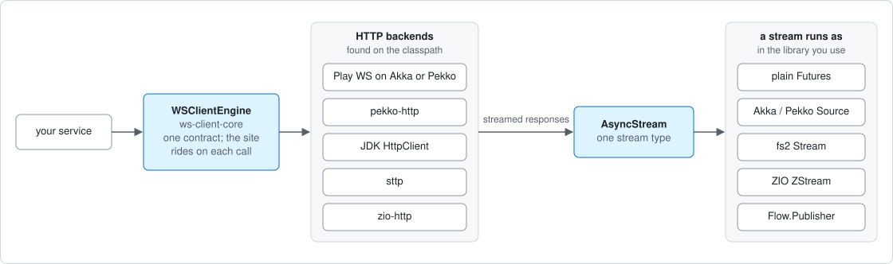

# WS Client
[](https://cequence.io) [](https://opensource.org/licenses/MIT) [](https://x.com/0xbnd) [](https://github.com/cequence-io/ws-client/actions/workflows/vulnerability-scan.yml) [](docs/dependencies.md) [](docs/dependencies.md)

A simple and efficient web-service client for Scala: one API to send requests to RESTful services, handle responses and manage errors - on the HTTP backend of your choice.

- **Pluggable HTTP engines** - Play WS (Akka or Pekko), pekko-http, JDK HttpClient, sttp and zio-http - picked up automatically from the classpath.
- **One engine, many sites** - an engine owns the HTTP client and its threads; the target site (base URL, auth, error recovery) rides on each call.
- **Streaming** - SSE / JSON and raw byte streams, as Akka / Pekko `Source`s, a JDK `Flow.Publisher`, or the backend-neutral `AsyncStream`.
- **Same behavior on every engine** - encoding, multipart, timeouts, typed failures, no redirects, no cookie jar.

**🔥 New in 1.2**: `AsyncStream` - one backend-neutral stream type for every engine, with native interop for Akka, Pekko, fs2 and ZIO (an engine's own `Source` comes back as itself, no bridge), binary-safe downloads on every streaming engine, a neutral `AsyncScheduler`, and Scala 3 artifacts for the Pekko modules. See [Streaming](docs/streaming.md) and the [changelog](CHANGELOG.md).

**🔐 Scanned every day**: all dependencies - including the libraries that other jars bundle under their own name, which ordinary scanners do not see - are checked daily against [OSV.dev](https://osv.dev) for known vulnerabilities, for `main` and (from 1.3.0 on) for the latest release. The result is public: see the badges above and [Security](#security-dependencies-and-vulnerability-scan-), with every accepted advisory and its reason in [Dependencies and vulnerabilities](docs/dependencies.md).

As a part of this suite we also provide the [json-repair](./json-repair/README.md) library that can be used to fix common JSON syntax errors, repair malformed JSON objects and arrays.

## Overview 🧭



### Backends

Add the module of a backend and ask `WSClientEngineRegistry` for an engine - with several on the classpath, the highest priority wins (or name one).

| Engine id | Module | HTTP client | Scala | Streamed responses |
|---|---|---|---|---|
| `play-pekko-stream` | ws-client-play-pekko-stream | Play WS 3.x on Pekko | 2.13, 3 | yes - Pekko `Source` |
| `play-pekko` | ws-client-play-pekko | Play WS 3.x on Pekko | 2.13, 3 | - |
| `pekko-http` | ws-client-pekko-http | pekko-http | 2.13, 3 | yes - Pekko `Source` |
| `play-akka-stream` | ws-client-play-akka-stream | Play WS 2.x on Akka | 2.12, 2.13, 3 | yes - Akka `Source` |
| `play-akka` | ws-client-play-akka | Play WS 2.x on Akka | 2.12, 2.13, 3 | - |
| `zio-http` | ws-client-zio-http | zio-http + the ZIO runtime | 2.12, 2.13 | yes - `Flow.Publisher`, ZIO `ZStream` |
| `sttp` | ws-client-sttp | sttp client4 (any sttp `Future` backend) | 2.12, 2.13 | - |
| `jdk` | ws-client-jdk | `java.net.http.HttpClient` (JDK 11+) | 2.12, 2.13, 3 | yes - `Flow.Publisher` |

Every streaming engine also returns its streams as an `AsyncStream`. Priorities, capabilities (streamed request bodies, multipart), discovery and lifecycle: [Engines](docs/engines.md).

### Stream abstractions

| Stream type | Module | Where it comes from |
|---|---|---|
| `AsyncStream[A]` - backend-neutral (since 1.2.0) | ws-client-core | every streaming engine (`execJsonAsyncStream`, `execRawAsyncStream`); runs on plain `Future`s and converts to every type below |
| Akka `Source` | ws-client-core-akka | the Akka engines (`execJsonStream`, `execRawStream`); `.toSource` on an `AsyncStream` |
| Pekko `Source` | ws-client-core-pekko | the Pekko engines, same names |
| fs2 `Stream` | ws-client-fs2 | `.toFs2[F]` on an `AsyncStream` |
| ZIO `ZStream` | ws-client-zio | `.toZStream` on an `AsyncStream` (native on `zio-http`) |
| `Flow.Publisher` (JDK) | ws-client-core | every streaming engine (`execJsonStreamPublisher`, `execRawStreamPublisher`); `.toPublisher` |

A stream consumed in its engine's own library is that engine's own stream - nothing is bridged. Semantics, operators and interop: [Streaming](docs/streaming.md).

## Installation 🚀

The currently supported Scala versions are **2.12, 2.13** and **3** for the core and the Akka-based modules, and **2.13** and **3** for the Pekko-based modules (per module: [Compatibility and upgrading](docs/compatibility.md#scala-versions)).

To install the library, add the following dependency to your *build.sbt*

```
"io.cequence" %% "ws-client-play-akka" % "1.2.2"     // Akka-based (Play WS 2.x)
```

or, for the Pekko flavor:

```
"io.cequence" %% "ws-client-play-pekko" % "1.2.2"    // Pekko-based (Play WS 3.x)
```

or to *pom.xml* (if you use maven)

```
<dependency>
    <groupId>io.cequence</groupId>
    <artifactId>ws-client-play-akka_2.12</artifactId>
    <version>1.2.2</version>
</dependency>
```

If you only need the core abstractions without Akka/Pekko dependencies:

```
"io.cequence" %% "ws-client-core" % "1.2.2"
```

Any other backend goes in the same way, by its module name from the table above - e.g. `ws-client-jdk` for a client without Akka, Pekko or Play WS. Use one version for all ws-client artifacts.

## Quick start 🏁

```scala
import io.cequence.wsclient.domain.{SiteBinding, WsRequestContext}
import io.cequence.wsclient.service.spi.WSClientEngineRegistry

import scala.concurrent.ExecutionContext.Implicits.global

val engine = WSClientEngineRegistry() // the engine found on the classpath

val site = SiteBinding(
  "https://api.example.com/v1",
  WsRequestContext(authHeaders = Seq("Authorization" -> "Bearer <token>"))
)

engine
  .execGETRich(site, "users", params = Seq("limit" -> Some(10)))
  .map(rich => println(rich.response.map(_.json))) // None for a status other than 200 / 201 / 202
  .andThen { case _ => engine.close() } // close an engine when done with it - it owns an HTTP client and its threads
```

A streamed response (SSE / JSON), on any engine that streams (since 1.2.0):

```scala
val streamed = WSClientEngineRegistry.outputStreamed()

streamed
  .execJsonAsyncStream(site, "events", "GET")   // AsyncStream[JsValue] - nothing is sent yet
  .map(json => (json \ "text").asOpt[String].getOrElse(""))
  .filter(_.nonEmpty)
  .runForeach(println)                          // the request is made per run
```

The same engine serves any number of sites - pass another `SiteBinding`. See [Sites and requests](docs/sites-and-requests.md).

## Good to know ⚠️

- **The Akka and Pekko flavors are mutually exclusive on one classpath** - they share package and class names, so code compiles unchanged against either. Set `ws-client.strict-classpath = true` in CI to fail on a mix.
- **Use one version for all ws-client artifacts.**
- **No logging backend is shipped** (SLF4J API only). Keep `play.shaded.ahc.org.asynchttpclient.netty.handler` at `INFO` or above: at `DEBUG` Play's shaded AsyncHttpClient logs complete request headers, including `Authorization`.
- **Upgrading from ≤ 0.8.1:** `ws-client-play` / `ws-client-play-stream` were renamed to `ws-client-play-akka` / `ws-client-play-akka-stream` - exclude the old artifacts.

Details for each: [Compatibility and upgrading](docs/compatibility.md). What changed in which version, behavior changes included: [CHANGELOG.md](CHANGELOG.md).

## Security: dependencies and vulnerability scan 🔐

<!-- dependency-matrix:start -->
<!-- generated by security/dependencies.py --write - do not edit -->

[](https://github.com/cequence-io/ws-client/actions/workflows/vulnerability-scan.yml) [](https://github.com/cequence-io/ws-client/actions/workflows/vulnerability-scan.yml) [](https://github.com/cequence-io/ws-client/actions/workflows/vulnerability-scan.yml) [](https://github.com/cequence-io/ws-client/actions/workflows/vulnerability-scan.yml) [](https://github.com/cequence-io/ws-client/actions/workflows/vulnerability-scan.yml) [](https://github.com/cequence-io/ws-client/actions/workflows/vulnerability-scan.yml) [](https://osv.dev)

**The scan.** Every day (and on every dependency change) all 252 artifacts the published modules bring - transitive ones and the libraries other jars bundle under their own name (Play WS's AsyncHttpClient and Netty, Akka's and Pekko's protobuf, ...) - are checked against [OSV.dev](https://osv.dev) (GitHub advisories, CVEs), for `main` and for the latest release. The badges above show the last run. A new advisory fails the scan and opens an issue: the dependency is upgraded, or - where no fixed version can be used - the advisory is accepted with its reason.

**Accepted today:** 56 advisories, all in libraries that Play WS and Akka bundle - 52 not reachable through ws-client, 2 closed in ws-client's own code, 2 open.

Open:
- `netty-common` 4.1.45.Final, 4.1.60.Final (CVE-2024-47535, CVE-2025-25193): Windows only, local attacker: at start-up Netty reads `C:\etc\os-release`, which a local user may create - a huge one exhausts the JVM's memory. It matters on a Windows host shared with untrusted local users. No Play WS release for Akka on Scala 2.12 or Scala 3 carries a fixed Netty: there, use Scala 2.13 (Play WS 2.2.18) or the Pekko flavor.

**The dependencies** the modules declare on `main` (the next release), with the versions each Scala version resolves. A module brings the libraries of its own rows and of the modules it builds on; where a cell lists several versions, a module further up resolves a newer one. Per module, the full lists and every accepted advisory: [Dependencies and vulnerabilities](docs/dependencies.md).

| Library | Scala 2.12 | Scala 2.13 | Scala 3 | Declared by |
|---|---|---|---|---|
| `co.fs2:fs2-core` | 3.12.2 | 3.12.2 | 3.12.2 | fs2 |
| `com.fasterxml.jackson.core:jackson-core` | 2.22.3 | 2.22.3 | 2.22.3 | json-repair, core |
| `com.fasterxml.jackson.core:jackson-databind` | 2.22.3 | 2.22.3 | 2.22.3 | json-repair, core |
| `com.fasterxml.jackson.datatype:jackson-datatype-jdk8` | 2.22.3 | 2.22.3 | 2.22.3 | json-repair, core |
| `com.fasterxml.jackson.datatype:jackson-datatype-jsr310` | 2.22.3 | 2.22.3 | 2.22.3 | json-repair, core |
| `com.softwaremill.sttp.client4:core` | 4.0.3 | 4.0.3 | - | sttp |
| `com.typesafe.akka:akka-http` | 10.5.3 | 10.5.3 | 10.5.3 | play-akka-stream |
| `com.typesafe.akka:akka-stream` | 2.6.20 | 2.6.21 | 2.6.20 | core-akka |
| `com.typesafe.play:play-ahc-ws-standalone` | 2.1.11 | 2.2.18 | 2.2.0-M2 | play-akka |
| `com.typesafe.play:play-json` | 2.8.2 | 2.8.2 | 2.10.0-RC6 | json-repair, core |
| `com.typesafe.play:play-ws-standalone-json` | 2.1.11 | 2.2.18 | 2.2.0-M2 | play-akka |
| `com.typesafe.scala-logging:scala-logging` | 3.9.5 | 3.9.5 | 3.9.5 | json-repair, core |
| `com.typesafe:config` | 1.4.3 | 1.4.3 / 1.4.6 | 1.4.3 / 1.4.6 | core |
| `com.typesafe:ssl-config-core` | 0.4.3 | 0.4.3 / 0.6.1 / 0.7.1 | 0.6.1 / 0.7.1 | core-akka |
| `dev.zio:zio-http` | 3.11.6 | 3.11.6 | 3.11.6 | zio-http |
| `dev.zio:zio-interop-reactivestreams` | 2.0.2 | 2.0.2 | 2.0.2 | zio-http |
| `dev.zio:zio-streams` | 2.1.26 | 2.1.26 | 2.1.26 | zio |
| `org.apache.pekko:pekko-http` | - | 1.3.0 | 1.3.0 | pekko-http, play-pekko-stream |
| `org.apache.pekko:pekko-stream` | - | 1.6.0 | 1.6.0 | core-pekko |
| `org.bouncycastle:bcpkix-jdk18on` | 1.86 | 1.86 | 1.86 | zio-http |
| `org.bouncycastle:bcprov-jdk18on` | 1.86 | 1.86 | 1.86 | zio-http |
| `org.bouncycastle:bcutil-jdk18on` | 1.86 | 1.86 | 1.86 | zio-http |
| `org.playframework:play-ahc-ws-standalone` | - | 3.0.14 | 3.0.14 | play-pekko |
| `org.playframework:play-ws-standalone-json` | - | 3.0.14 | 3.0.14 | play-pekko |
| `org.typelevel:cats-effect` | 3.6.3 | 3.6.3 | 3.6.3 | fs2 |
| `org.scala-lang:scala-library` | 2.12.18 | 2.13.18 | 2.13.10 / 2.13.18 | every module |
| `org.scala-lang:scala3-library` | - | - | 3.2.2 / 3.3.8 | every module |

Bundled inside other jars (shaded or vendored - not visible as dependencies), with the bundled version per Scala version:

| Jar | Bundles | Scala 2.12 | Scala 2.13 | Scala 3 |
|---|---|---|---|---|
| `com.fasterxml.jackson.core:jackson-core` | `ch.randelshofer:fastdoubleparser` | 2.0.1 | 2.0.1 | 2.0.1 |
| `com.typesafe.akka:akka-http-core` | `com.twitter:hpack` | source copy | source copy | source copy |
| `com.typesafe.akka:akka-protobuf-v3` | `com.google.protobuf:protobuf-java` | 3.16.1 | 3.16.1 | 3.16.1 |
| `com.typesafe.play:shaded-asynchttpclient` | Netty | 4.1.45.Final | 4.1.138.Final | 4.1.60.Final |
| `com.typesafe.play:shaded-asynchttpclient` | `org.asynchttpclient:async-http-client` | 2.10.5 | 2.16.1 | 2.12.3 |
| `com.typesafe.play:shaded-oauth` | `commons-codec:commons-codec` | 1.3 | - | - |
| `com.typesafe.play:shaded-oauth` | `oauth.signpost:signpost-core` | 1.2.1.2 | 2.1.1 | 2.1.1 |
| `dev.zio:izumi-reflect-thirdparty-boopickle-shaded` | `io.suzaku:boopickle` | source copy | source copy | source copy |
| `io.netty:netty-common` | `org.jctools:jctools-core-jdk11` | 4.0.7 | 4.0.7 | 4.0.7 |
| `io.netty:netty-common` | `org.jctools:jctools-core` | 4.0.7 | 4.0.7 | 4.0.7 |
| `org.apache.pekko:pekko-http-core` | `com.twitter:hpack` | - | source copy | source copy |
| `org.apache.pekko:pekko-protobuf-v3` | `com.google.protobuf:protobuf-java` | - | 4.33.5 | 4.33.5 |
| `org.playframework:shaded-asynchttpclient` | Netty | - | 4.1.138.Final | 4.1.138.Final |
| `org.playframework:shaded-asynchttpclient` | `org.asynchttpclient:async-http-client` | - | 2.16.1 | 2.16.1 |
| `org.playframework:shaded-oauth` | `oauth.signpost:signpost-core` | - | 2.1.1 | 2.1.1 |
<!-- dependency-matrix:end -->

## Documentation 📚

| Page | What it covers |
|------|----------------|
| [Engines](docs/engines.md) | The backends compared; self-discovery, config keys, typed streaming engines; ownership and `close()` |
| [Sites and requests](docs/sites-and-requests.md) | One engine for many sites, copying an engine; query encoding, cookies, redirects, headers, proxies, error recovery, rich responses, request signing |
| [Calls](docs/calls.md) | `AsyncCall` (since 1.3.0): a request as a lazy, backend-neutral value - run as a `Future` or natively as a ZIO effect (interruption aborts the request on `zio-http`); operators, timeouts, `traverse`, bridges |
| [Streaming](docs/streaming.md) | The stream types at a glance; `AsyncStream` semantics, operators and interop with Akka, Pekko, fs2 and ZIO; downloads; `Source`- and `Flow.Publisher`-typed streams |
| [Architecture](docs/architecture.md) | Layers, modules and their dependencies, the trait hierarchy, design rules, service adapters |
| [Compatibility and upgrading](docs/compatibility.md) | Akka vs Pekko, one version for all artifacts, the 1.0.0 artifact rename, logging, Scala and Java versions |
| [Dependencies and vulnerabilities](docs/dependencies.md) | Every module's dependencies per Scala version, bundled libraries included; the daily vulnerability scan and the accepted advisories |
| [Verification](docs/verification.md) | Small-scope specs, model checks, TLA+ specs and Lean proofs - what they cover and what not |
| [Changelog](CHANGELOG.md) | Release notes per version, with behavior changes and upgrade notes |
| [json-repair](json-repair/README.md) | The JSON repair library |

## License ⚖️

This library is available and published as open source under the terms of the [MIT License](https://opensource.org/licenses/MIT).
