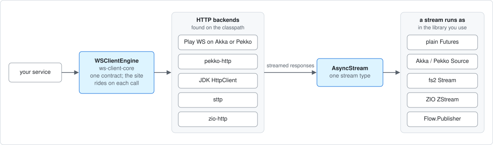

# WS Client
[](https://cequence.io) [](https://opensource.org/licenses/MIT) [](https://x.com/0xbnd)

A simple and efficient web-service client for Scala: one API to send requests to RESTful services, handle responses and manage errors - on the HTTP backend of your choice.

- **Pluggable HTTP engines** - Play WS (Akka or Pekko), pekko-http, JDK HttpClient, sttp and zio-http - picked up automatically from the classpath.
- **One engine, many sites** - an engine owns the HTTP client and its threads; the target site (base URL, auth, error recovery) rides on each call.
- **Streaming** - SSE / JSON and raw byte streams, as Akka / Pekko `Source`s, a JDK `Flow.Publisher`, or the backend-neutral `AsyncStream`.
- **Same behavior on every engine** - encoding, multipart, timeouts, typed failures, no redirects, no cookie jar.

**🔥 New in 1.2**: `AsyncStream` - one backend-neutral stream type for every engine, with native interop for Akka, Pekko, fs2 and ZIO (an engine's own `Source` comes back as itself, no bridge), binary-safe downloads on every streaming engine, a neutral `AsyncScheduler`, and Scala 3 artifacts for the Pekko modules. See [Streaming](docs/streaming.md) and the [changelog](CHANGELOG.md).

As a part of this suite we also provide the [json-repair](./json-repair/README.md) library that can be used to fix common JSON syntax errors, repair malformed JSON objects and arrays.

## Overview 🧭



### Backends

Add the module of a backend and ask `WSClientEngineRegistry` for an engine - with several on the classpath, the highest priority wins (or name one).

| Engine id | Module | HTTP client | Scala | Streamed responses |
|---|---|---|---|---|
| `play-pekko-stream` | ws-client-play-pekko-stream | Play WS 3.x on Pekko | 2.13, 3 | yes - Pekko `Source` |
| `play-pekko` | ws-client-play-pekko | Play WS 3.x on Pekko | 2.13, 3 | - |
| `pekko-http` | ws-client-pekko-http | pekko-http | 2.13, 3 | yes - Pekko `Source` |
| `play-akka-stream` | ws-client-play-akka-stream | Play WS 2.x on Akka | 2.12, 2.13, 3 | yes - Akka `Source` |
| `play-akka` | ws-client-play-akka | Play WS 2.x on Akka | 2.12, 2.13, 3 | - |
| `zio-http` | ws-client-zio-http | zio-http + the ZIO runtime | 2.12, 2.13 | yes - `Flow.Publisher`, ZIO `ZStream` |
| `sttp` | ws-client-sttp | sttp client4 (any sttp `Future` backend) | 2.12, 2.13 | - |
| `jdk` | ws-client-jdk | `java.net.http.HttpClient` (JDK 11+) | 2.12, 2.13, 3 | yes - `Flow.Publisher` |

Every streaming engine also returns its streams as an `AsyncStream`. Priorities, capabilities (streamed request bodies, multipart), discovery and lifecycle: [Engines](docs/engines.md).

### Stream abstractions

| Stream type | Module | Where it comes from |
|---|---|---|
| `AsyncStream[A]` - backend-neutral (since 1.2.0) | ws-client-core | every streaming engine (`execJsonAsyncStream`, `execRawAsyncStream`); runs on plain `Future`s and converts to every type below |
| Akka `Source` | ws-client-core-akka | the Akka engines (`execJsonStream`, `execRawStream`); `.toSource` on an `AsyncStream` |
| Pekko `Source` | ws-client-core-pekko | the Pekko engines, same names |
| fs2 `Stream` | ws-client-fs2 | `.toFs2[F]` on an `AsyncStream` |
| ZIO `ZStream` | ws-client-zio | `.toZStream` on an `AsyncStream` (native on `zio-http`) |
| `Flow.Publisher` (JDK) | ws-client-core | every streaming engine (`execJsonStreamPublisher`, `execRawStreamPublisher`); `.toPublisher` |

A stream consumed in its engine's own library is that engine's own stream - nothing is bridged. Semantics, operators and interop: [Streaming](docs/streaming.md).

## Installation 🚀

The currently supported Scala versions are **2.12, 2.13** and **3** for the core and the Akka-based modules, and **2.13** and **3** for the Pekko-based modules (per module: [Compatibility and upgrading](docs/compatibility.md#scala-versions)).

To install the library, add the following dependency to your *build.sbt*

```
"io.cequence" %% "ws-client-play-akka" % "1.2.1"     // Akka-based (Play WS 2.x)
```

or, for the Pekko flavor:

```
"io.cequence" %% "ws-client-play-pekko" % "1.2.1"    // Pekko-based (Play WS 3.x)
```

or to *pom.xml* (if you use maven)

```
<dependency>
    <groupId>io.cequence</groupId>
    <artifactId>ws-client-play-akka_2.12</artifactId>
    <version>1.2.1</version>
</dependency>
```

If you only need the core abstractions without Akka/Pekko dependencies:

```
"io.cequence" %% "ws-client-core" % "1.2.1"
```

Any other backend goes in the same way, by its module name from the table above - e.g. `ws-client-jdk` for a client without Akka, Pekko or Play WS. Use one version for all ws-client artifacts.

## Quick start 🏁

```scala
import io.cequence.wsclient.domain.{SiteBinding, WsRequestContext}
import io.cequence.wsclient.service.spi.WSClientEngineRegistry

import scala.concurrent.ExecutionContext.Implicits.global

val engine = WSClientEngineRegistry() // the engine found on the classpath

val site = SiteBinding(
  "https://api.example.com/v1",
  WsRequestContext(authHeaders = Seq("Authorization" -> "Bearer <token>"))
)

engine
  .execGETRich(site, "users", params = Seq("limit" -> Some(10)))
  .map(rich => println(rich.response.map(_.json))) // None for a status other than 200 / 201 / 202
  .andThen { case _ => engine.close() } // close an engine when done with it - it owns an HTTP client and its threads
```

A streamed response (SSE / JSON), on any engine that streams (since 1.2.0):

```scala
val streamed = WSClientEngineRegistry.outputStreamed()

streamed
  .execJsonAsyncStream(site, "events", "GET")   // AsyncStream[JsValue] - nothing is sent yet
  .map(json => (json \ "text").asOpt[String].getOrElse(""))
  .filter(_.nonEmpty)
  .runForeach(println)                          // the request is made per run
```

The same engine serves any number of sites - pass another `SiteBinding`. See [Sites and requests](docs/sites-and-requests.md).

## Good to know ⚠️

- **The Akka and Pekko flavors are mutually exclusive on one classpath** - they share package and class names, so code compiles unchanged against either. Set `ws-client.strict-classpath = true` in CI to fail on a mix.
- **Use one version for all ws-client artifacts.**
- **No logging backend is shipped** (SLF4J API only). Keep `play.shaded.ahc.org.asynchttpclient.netty.handler` at `INFO` or above: at `DEBUG` Play's shaded AsyncHttpClient logs complete request headers, including `Authorization`.
- **Upgrading from ≤ 0.8.1:** `ws-client-play` / `ws-client-play-stream` were renamed to `ws-client-play-akka` / `ws-client-play-akka-stream` - exclude the old artifacts.

Details for each: [Compatibility and upgrading](docs/compatibility.md). What changed in which version, behavior changes included: [CHANGELOG.md](CHANGELOG.md).

## Documentation 📚

| Page | What it covers |
|------|----------------|
| [Engines](docs/engines.md) | The backends compared; self-discovery, config keys, typed streaming engines; ownership and `close()` |
| [Sites and requests](docs/sites-and-requests.md) | One engine for many sites, copying an engine; query encoding, cookies, redirects, headers, proxies, error recovery, rich responses, request signing |
| [Streaming](docs/streaming.md) | The stream types at a glance; `AsyncStream` semantics, operators and interop with Akka, Pekko, fs2 and ZIO; downloads; `Source`- and `Flow.Publisher`-typed streams |
| [Architecture](docs/architecture.md) | Layers, modules and their dependencies, the trait hierarchy, design rules, service adapters |
| [Compatibility and upgrading](docs/compatibility.md) | Akka vs Pekko, one version for all artifacts, the 1.0.0 artifact rename, logging, Scala and Java versions |
| [Verification](docs/verification.md) | Small-scope specs, model checks and TLA+ specs of the stream layer - what they cover and what not |
| [Changelog](CHANGELOG.md) | Release notes per version, with behavior changes and upgrade notes |
| [json-repair](json-repair/README.md) | The JSON repair library |

## License ⚖️

This library is available and published as open source under the terms of the [MIT License](https://opensource.org/licenses/MIT).
