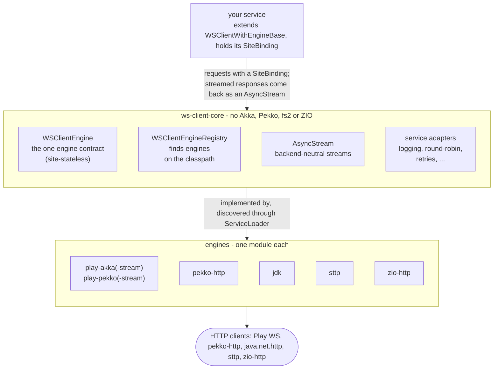
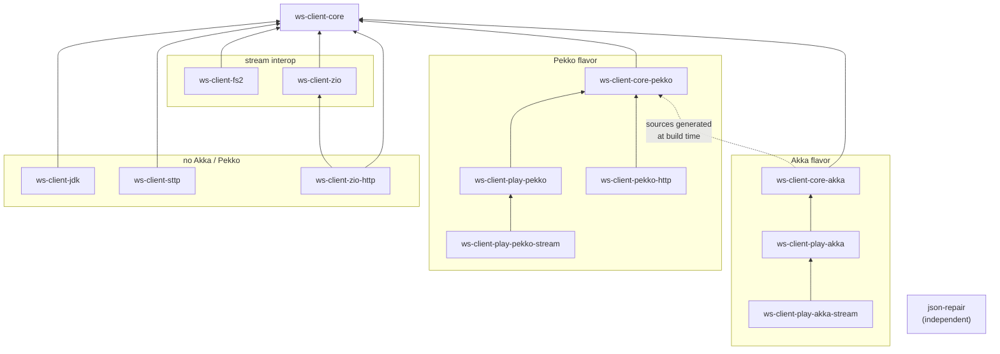
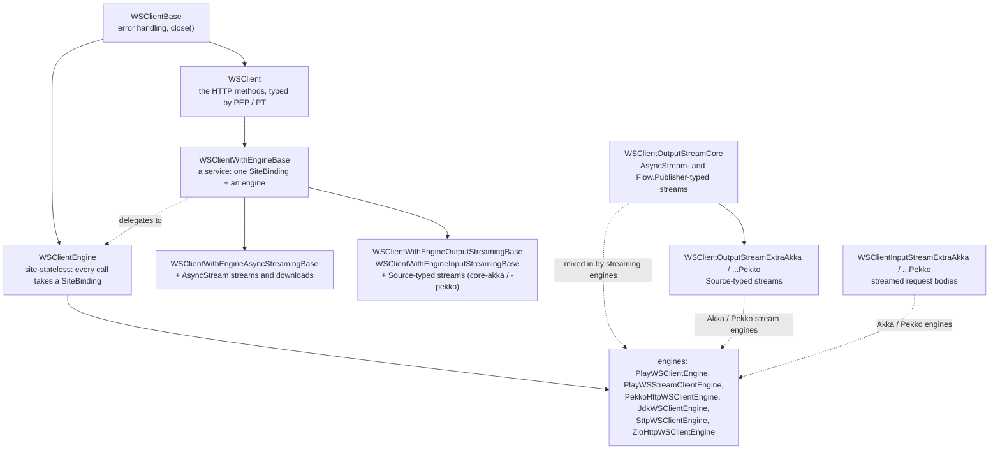

# Architecture 🏗️

[← back to the README](../README.md)

How the library is put together: the layers between your code and an HTTP client, the modules
and what depends on what, the traits a service and an engine are built from, and the design
rules behind them.

## Layers



- **Core** defines the contracts and everything backend-independent: the engine contract, the
  discovery SPI, the domain model (`SiteBinding`, `WsRequestContext`, `Response`,
  `RichResponse`, the `CequenceWSException` family), service adapters and - since 1.2.0 - the
  stream layer. It depends only on play-json, Jackson, Typesafe config and scala-logging.
- **An engine** implements the contract on one HTTP library and registers itself for discovery.
  See [Engines](engines.md).
- **Streams** leave an engine in its library's own type and, since 1.2.0, as a backend-neutral
  `AsyncStream`. See [Streaming](streaming.md).

## Modules



An arrow reads "depends on".

Akka flavor (Scala 2.12, 2.13, 3):

- **ws-client-core** - core abstractions and interfaces (Akka-free), the engine-discovery SPI
  and the stream layer
- **ws-client-core-akka** - Akka-based streaming extensions (`Source`-typed streaming traits,
  `StreamedEngineRegistry`, the `AsyncStream` interop for Akka)
- **ws-client-play-akka** - the Play WS 2.x backend (depends on core-akka); named
  `ws-client-play` before 1.0.0
- **ws-client-play-akka-stream** - adds SSE / JSON response streaming (akka-http); named
  `ws-client-play-stream` before 1.0.0

Pekko flavor (Scala 2.13, 3; sources generated from the Akka modules at build time):

- **ws-client-core-pekko** - Pekko-based streaming extensions
- **ws-client-play-pekko** - the Play WS 3.x (`org.playframework`) backend
- **ws-client-play-pekko-stream** - adds SSE / JSON response streaming (pekko-http)
- **ws-client-pekko-http** - a direct pekko-http backend (handwritten, not generated)

Other backends:

- **ws-client-jdk** - on the JDK 11+ `java.net.http.HttpClient` (Scala 2.12, 2.13, 3)
- **ws-client-sttp** - over [sttp client4](https://sttp.softwaremill.com) (Scala 2.12, 2.13)
- **ws-client-zio-http** - on the [zio-http](https://zio.dev/zio-http) client and the ZIO
  runtime (Scala 2.12, 2.13)

Stream interop (see [Streaming](streaming.md)):

- **ws-client-fs2** - `AsyncStream` <-> fs2 `Stream` / `Pipe` (Scala 2.12, 2.13, 3)
- **ws-client-zio** - `AsyncStream` <-> ZIO `ZStream` / `ZPipeline` (Scala 2.12, 2.13, 3)
- the Akka / Pekko interop lives in **ws-client-core-akka** / **ws-client-core-pekko**

Independent:

- **[json-repair](../json-repair/README.md)** - JSON repair utility

The details per backend are on the [Engines](engines.md) page, the Scala versions per module
under [Compatibility and upgrading](compatibility.md#scala-versions).

### Two flavors from one source

The Pekko modules are **generated** from the Akka ones at build time (an `akka.*` →
`org.apache.pekko.*` rewrite), so both flavors behave alike and share their package and class
names - downstream code compiles unchanged against either, and the two are
[mutually exclusive on one classpath](compatibility.md#akka-or-pekko---never-both).

## Traits

A **service** (your API client) extends a service base and holds its site; an **engine**
executes requests for any site.



- `WSClient` defines the HTTP methods with two type members, `PEP` (endpoint) and `PT`
  (parameter) - commonly enums of the service.
- Every method comes as `execX` (fails on a non-acceptable status) and `execXRich` (a
  `RichResponse` with status and headers either way) - see
  [Sites and requests](sites-and-requests.md#rich-responses).
- `WSClientWithEngineBase` holds the service's `SiteBinding` once and threads it into every
  engine call; a service closes its engine only when it owns it.
- Streaming is added by mixins: a capability an engine lacks is a trait it does not have, and
  the registries filter providers by capability.

## Design rules

- **Engines are site-stateless.** Client-level settings (`TransportSettings`: timeouts, proxy,
  HTTP version) belong to the engine; everything site-specific rides in the per-call
  `SiteBinding`. One engine serves any number of sites; no per-site client caches.
- **One behavior on every engine.** Query encoding, multipart encoding, JSON body rendering,
  redirects (never followed), cookies (never stored), timeouts covering the response body, the
  status check before a streamed body, SSE frame parsing - each is one shared implementation or
  one shared test scenario that every engine passes.
- **Failures are typed.** Timeouts, unresolvable hosts, HTTP status failures and oversized
  frames arrive as a failed `Future` with a `CequenceWSException` subclass
  (`CequenceWSTimeoutException`, `CequenceWSUnknownHostException`,
  `CequenceWSHttpStatusException`, `CequenceWSFrameTooLongException`), the same on every
  engine. Other transport failures are not uniform yet: a refused connection is a
  `java.net.ConnectException` (or a wrapper of it) on the Play, `pekko-http`, `zio-http` and
  `jdk` engines and a `CequenceWSException` on `sttp`. Messages never carry the request URL
  (query parameters may hold API keys).
- **Discovery over wiring.** Backends register through `java.util.ServiceLoader`; code that
  asks the registry for an engine does not name a backend class.
- **Streams are plans.** An `AsyncStream` is an immutable description; whoever consumes it
  compiles it for its own library, so an engine's native stream stays native for a consumer of
  the same library.

## Service adapters

Composable wrappers around a service, in `io.cequence.wsclient.service.adapter`
(`ServiceBaseAdapters`): `roundRobin` and `randomOrder` over several services, `log`,
`preAction` (an action before each call), `repackExceptions`; Akka-free
`ParallelServiceAdapters.parallelTakeFirst` (the first response of several services wins), and
`parallelTakeFirst` of `ServiceBaseAdaptersAkka` for Akka / Pekko code.

```scala
val service = roundRobin(service1, service2, service3)   // load balancing
val logged  = log(service, "MyService")                  // request logging
```
