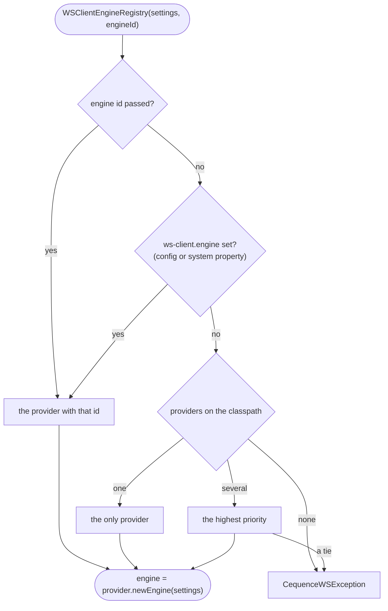

# Engines 🔌

[← back to the README](../README.md)

An **engine** is one HTTP backend behind the common `WSClientEngine` contract. Engines are picked
up from the classpath: add the backend's module, ask the registry for an engine, done. This page
lists the backends, how one is selected, and who owns what.

## The backends

| Engine id | Module | HTTP client | Scala | Priority | Capabilities | `AsyncStream` (since 1.2) |
|---|---|---|---|---|---|---|
| `play-pekko-stream` | ws-client-play-pekko-stream | Play WS 3.x (shaded AsyncHttpClient / Netty) on Pekko | 2.13, 3.3 | 21 | input + output streaming, multipart | native Pekko `Source` |
| `play-pekko` | ws-client-play-pekko | Play WS 3.x on Pekko | 2.13, 3.3 | 20 | input streaming, multipart | - |
| `pekko-http` | ws-client-pekko-http | pekko-http | 2.13, 3.3 | 15 | input + output streaming, multipart | native Pekko `Source` |
| `play-akka-stream` | ws-client-play-akka-stream | Play WS 2.x (shaded AsyncHttpClient / Netty) on Akka | 2.12, 2.13, 3 | 11 | input + output streaming, multipart | native Akka `Source` |
| `play-akka` | ws-client-play-akka | Play WS 2.x on Akka | 2.12, 2.13, 3 | 10 | input streaming, multipart | - |
| `zio-http` | ws-client-zio-http | zio-http (Netty) + the ZIO runtime | 2.12, 2.13 | 7 | output streaming (`Flow.Publisher`), multipart | native ZIO `ZStream` |
| `sttp` | ws-client-sttp | sttp client4 (by default on `java.net.http`) | 2.12, 2.13 | 5 | multipart | - |
| `jdk` | ws-client-jdk | `java.net.http.HttpClient` (JDK 11+) | 2.12, 2.13, 3 | 0 | output streaming (`Flow.Publisher`), multipart (in-memory) | via `Flow.Publisher` |

- **Input streaming** is a streamed request body (`execPOSTSource`), **output streaming** a
  streamed response (SSE / JSON frames, raw bytes) - see [Streaming](streaming.md).
- The stream engines are strict supersets of their base engines (same implementation plus SSE /
  JSON output streaming), hence the slightly higher priorities.
- Auto-selection picks the highest priority present. Engines that stream only through
  `Flow.Publisher` rank below every Akka / Pekko engine.

Which one?

- **An Akka or Pekko application:** `play-akka-stream` / `play-pekko-stream` (or `pekko-http`
  when you want no Play WS / shaded AsyncHttpClient layer).
- **No Akka, no Pekko, fewest dependencies:** `jdk` - it needs only `ws-client-core`.
- **A ZIO application:** `zio-http`, optionally on your own `Client`.
- **Any other HTTP stack** (OkHttp, Armeria, ...): `sttp` with a custom sttp `Future` backend.

### Notes per backend

- **ws-client-play-akka / ws-client-play-akka-stream** - Play WS 2.x; named `ws-client-play` /
  `ws-client-play-stream` before 1.0.0 (see
  [Compatibility and upgrading](compatibility.md#artifacts-renamed-in-100)). The `-stream`
  module adds SSE / JSON response streaming.
- **ws-client-play-pekko / ws-client-play-pekko-stream** - Play WS 3.x (`org.playframework`);
  the sources are generated from the Akka modules at build time, so both flavors behave alike.
- **ws-client-jdk** - no Akka / Pekko / Play WS: it needs only `ws-client-core` (play-json,
  Jackson, Typesafe config, scala-logging). Multipart bodies are built in memory.
  `TransportSettings.httpVersion` selects HTTP/1.1 or HTTP/2.
- **ws-client-sttp** - over [sttp client4](https://sttp.softwaremill.com), unlocking any sttp
  `Future` backend (OkHttp, Armeria, Pekko-HTTP, ...) through `SttpWSClientEngine(...)`.
- **ws-client-pekko-http** - a direct pekko-http client, no Play WS / shaded AsyncHttpClient
  layer; supports input and output (SSE) streaming. It ignores `TransportSettings.proxyURL`
  (with a warning).
- **ws-client-zio-http** - the [zio-http](https://zio.dev/zio-http) (Netty) client and the ZIO
  runtime; output (SSE) streaming via `Flow.Publisher`; since 1.2.0 its `AsyncStream`s are
  native ZIO streams (it depends on ws-client-zio). Server certificates are verified against
  the JVM's default trust store (`ClientSSLConfig.FromSystemTrustStore`). A ZIO application can
  run it on its own `Client` via `ZioHttpWSClientEngine.layer()` - then configure that client's
  `.ssl(...)` yourself, as zio-http's default trusts any certificate. With a proxy, target host
  names are still resolved through local DNS.

## Self-discovery 🔎

Backends register a `WSClientEngineProvider` via `java.util.ServiceLoader`, so an engine can be
obtained without naming the backend class:

```scala
import io.cequence.wsclient.service.spi.{TransportSettings, WSClientEngineRegistry}

val engine = WSClientEngineRegistry() // site-stateless: the target site rides on each call
// ... use the engine (it owns its actor system) ...
engine.close() // releases the HTTP client and the owned actor system; idempotent
```

Provider resolution order:

1. an explicit engine id: `WSClientEngineRegistry(TransportSettings(), Some("play-pekko"))`
2. the config key `ws-client.engine` (also settable as a system property,
   `-Dws-client.engine=play-akka`, which takes precedence per standard Typesafe Config semantics)
3. auto-selection: a single provider is used as is; with several, the highest priority wins



Config keys:

| Key | Default | Meaning |
|---|---|---|
| `ws-client.engine` | (unset) | Engine id to use when none is passed explicitly |
| `ws-client.strict-classpath` | `false` | Fail engine resolution (instead of logging a warning) when mutually exclusive ws-client artifacts are detected on the classpath - mixed Akka / Pekko flavors, or a pre-1.0 artifact (`ws-client-play`, `ws-client-play-stream`) next to its renamed successor |

Note for sbt-assembly users: ServiceLoader registrations live in `META-INF/services`, so fat
jars need `MergeStrategy.concat` (or `filterDistinctLines`) for that path.

## Typed streaming engines

For a **typed streaming engine** use `StreamedEngineRegistry` (in ws-client-core-akka /
ws-client-core-pekko) - the core registry cannot mention Akka / Pekko types, so this typed lookup
filters providers by capability and returns the streaming-typed engine:

```scala
import io.cequence.wsclient.service.spi.{StreamedEngineRegistry, TransportSettings}

// WSClientEngine with WSClientOutputStreamExtraAkka (Pekko: ...ExtraPekko) - for execJsonStream / execRawStream (SSE)
val streamedEngine = StreamedEngineRegistry.outputStreamed()

// WSClientEngine with WSClientInputStreamExtraAkka (Pekko: ...ExtraPekko) - for execPOSTSource
val inputEngine = StreamedEngineRegistry.inputStreamed()
```

The backend-agnostic alternative (no Akka / Pekko on the consumer side; works with the `jdk`
engine) is `WSClientEngineRegistry.outputStreamed(...)`: it returns
`WSClientEngine with WSClientOutputStreamCore` - the `AsyncStream`-typed `execJsonAsyncStream` /
`execRawAsyncStream` and the `java.util.concurrent.Flow.Publisher`-typed
`execJsonStreamPublisher` / `execRawStreamPublisher`.

`sttp`, `play-akka` and `play-pekko` have no output streaming: resolve streamed services through
`WSClientEngineRegistry.outputStreamed`, which picks the highest-priority engine that streams -
with `play-akka` and `jdk` on one classpath, streams then run on `jdk`.

## Ownership and lifecycle

Engines created through discovery own their execution environment (actor system / backend):

- An Akka / Pekko-based engine owns a DAEMON-threaded `ActorSystem`: `close()` terminates the
  HTTP client and that system, and a leaked engine won't block JVM exit. `close()` is
  idempotent.
- To supply your own `Materializer` / `ExecutionContext` / backend - e.g. to share one
  `ActorSystem` - use the explicit factories: `PlayWSClientEngine(transportSettings)`,
  `PlayWSStreamClientEngine(...)`, `JdkWSClientEngine(...)`, `SttpWSClientEngine(...)`,
  `PekkoHttpWSClientEngine(...)`, `ZioHttpWSClientEngine(client)` /
  `ZioHttpWSClientEngine.layer()`. They take only client-level `TransportSettings`; the site is
  per call. Engines built that way never touch your environment on `close()`.

One engine serves any number of sites, and a copy of an engine gets its own client-level
settings - see [Sites and requests](sites-and-requests.md).
