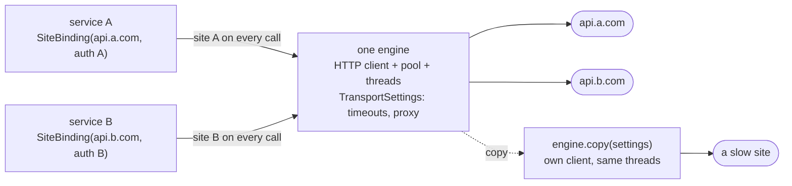

# Sites and requests 🔗

[← back to the README](../README.md)

Engines are **site-stateless**: an engine owns the HTTP client, the connection pool and its
execution environment, and every call names its target site. This page covers that split and the
request rules every engine shares - encoding, cookies, headers, proxies, error recovery and
request signing.

## One engine, many sites

An engine is configured by `TransportSettings` (timeouts, proxy), while everything site-specific
(base URL, auth context, error recovery, logging label) rides in a `SiteBinding` passed to every
call. Timeouts are deliberately engine-level only - keeping engines fully stateless (no per-site
client caches); a service that needs different timeouts uses its own engine. ONE engine
therefore serves any number of sites / providers:



```scala
import io.cequence.wsclient.domain.SiteBinding
import io.cequence.wsclient.service.spi.{StreamedEngineRegistry, TransportSettings}

val engine = StreamedEngineRegistry.outputStreamed()   // one pool + one (daemon) actor system
// non-streaming variant: WSClientEngineRegistry()

val siteA = SiteBinding("https://api.a.com", ctxA, label = Some("a"))
val siteB = SiteBinding("https://api.b.com", ctxB, label = Some("b"))

engine.execGETRich(siteA, "models")            // same engine...
engine.execJsonStream(siteB, "chat", "POST")   // ...different site per call

engine.close()  // the one teardown - close it once, when done with all sites/services
```

Services built on `WSClientWithEngineBase` hold their `SiteBinding` once and the base threads it
into every call; a service closes the engine only when it owns it (`ownsEngine` - false for
shared, caller-supplied engines).

## Different settings for one consumer: copy the engine

Need different client-level settings (timeouts, proxy) for one consumer? **Copy the engine** -
the copy builds its OWN HTTP client from the (optionally overridden) settings and is closed
independently (on `pekko-http` a copy on the same actor system shares that system's per-host
connection pools - pekko-http keeps them per system, keyed by host and pool settings):

```scala
val slow = engine.copy(TransportSettings(timeouts = Timeouts(requestTimeout = Some(600000))))
// ^ own client, SAME actor system/materializer/EC - close the env-owning original AFTER its copies
val island = engine.copy(reuseExecContext = false)
// ^ fully independent: its own owned daemon actor system (discovery-created engines only;
//   engines built on a caller-supplied environment throw - create those via their factory)
```

## Request rules shared by every engine

**Query-parameter encoding**: every engine takes **raw (unencoded) parameter keys and values** -
`params` and `WsRequestContext.extraParams` - and percent-encodes them for you. Up to 1.1.4 the
Play-based engines put them into the URL verbatim: a `#` cut the query off (with every parameter
after it, extra params included), `&` and `=` split a value, and `+` read as a space. If you
pre-encoded values for the Play engines, stop: a pre-encoded value like `a%20b` is now sent as
the literal text `a%20b`, as on every other engine. A query written into the endpoint string
itself (e.g. `"items?api-version=2024-02-01"`) is not a parameter - encode that one yourself.

**Cookies**: engines keep no cookie jar - a `Set-Cookie` response header is surfaced in
`RichResponse.headers` but never stored or sent on a later request, so one site's (or tenant's)
cookies can never reach another `SiteBinding`. A site that needs a cookie sends it itself, as a
`Cookie` header in its `WsRequestContext` (or from `requestContextFun`).

**Redirects**: no engine follows redirects - a 3xx comes back as a non-acceptable status.
Following one would re-send bodies and secret headers to whatever origin the `Location` names.

**Restricted headers**: `java.net.http` refuses a few headers it sets itself (`Host`,
`Connection`, `Content-Length`, `Expect`, `Upgrade` on current JDKs). Since 1.2.0 the `jdk`
engine - and `sttp` on its own JDK backend - drops such a header with a one-time warning instead
of failing the request (up to 1.1.5 the request failed). Whatever the JDK lets through,
including `-Djdk.httpclient.allowRestrictedHeaders`, is still sent, and any other header the JDK
refuses (JDK 11 before 11.0.14 also refuses e.g. `Referer` and `Origin`) still fails the
request. The other engines hand the header to their HTTP library, which may still set its own
value (e.g. `Host` from the URL).

**Repeated header names**: a header name given more than once - in `WsRequestContext.authHeaders`,
`extraHeaders` or both - keeps every value, in order. Most engines send one header line per value;
`zio-http`, whose client keeps one line per name, sends one line with the values joined by `, `
(`; ` for `Cookie`), which HTTP defines as the same field. Up to 1.2.0 `zio-http` and `sttp` sent
only the last value - Anthropic's one `anthropic-beta` line per beta flag lost all flags but one.
`Content-Type` is the exception: it is single-valued, so its last value wins on every engine - a
per-call `Content-Type` overrides the site's. A header the HTTP library sets by default (sttp's
`Accept-Encoding: gzip, deflate`) is replaced by the caller's.

**Proxy support**: `TransportSettings.proxyURL` (accepted forms: `host:port` or
`scheme://host:port`; only the host and port are used - the proxy is always a plain HTTP proxy,
even with an `https://` scheme (`https` targets are still tunnelled through it), and
credentials, path or query in the URL are ignored: proxy authentication is not supported) is
honored by the Play, `jdk`, `sttp`, and `zio-http` engines (`zio-http` tunnels via `CONNECT` and
still resolves the target host through local DNS); the `pekko-http` engine logs a warning and
ignores it (pekko-http only supports CONNECT-tunneling proxies).

**Custom error recovery** (`SiteBinding.recoverErrors`) composes with the engine's built-in
transport-failure normalization: your partial function sees the Cequence exception taxonomy
(`CequenceWSTimeoutException`, `CequenceWSUnknownHostException`, ...) for timeouts and
unresolvable hosts on every engine, so recovery written for those is portable. Other failures
reach it as the engine reports them - a refused connection is a `java.net.ConnectException` (or
a wrapper of it) on the Play, `pekko-http`, `zio-http` and `jdk` engines and a
`CequenceWSException` on `sttp`, so match on the cause chain there.

**Dynamic request context** (`SiteBinding.requestContextFun`): when set, the request context is
re-evaluated on every request - e.g. to refresh an expiring auth token - on all engines.
Client-level settings (`TransportSettings`: connect timeout, proxy; all timeouts on the Play
engines) are captured once, at engine construction or first use.

## Rich responses

Every HTTP method comes in two variants: `execGET(...)` returns a `Future[Response]` and fails
on a non-acceptable status; `execGETRich(...)` returns a `Future[RichResponse]` that carries the
status and headers either way, with `response` empty for a status outside
`acceptableStatusCodes`. Engine-level calls are the `*Rich` ones; services on
`WSClientWithEngineBase` expose both.

```scala
engine.execGETRich(site, "users", acceptableStatusCodes = Seq(200, 404)).map { rich =>
  rich.response match {
    case Some(response) => response.json      // or .string / .bytes (the body exactly as received)
    case None           => rich.status.code   // a status outside acceptableStatusCodes
  }
}
```

## Request signing

For signers such as AWS SigV4: `engine.renderJsonBody(json)` is the exact JSON text an engine
sends - every engine renders bodies the same way, as Play WS does (`WireFormat.jsonBody`) - and
`engine.wireUrl(site, endPoint, endPointParam, params)` the exact URL, query parameters
included. The Play and `jdk` engines send a query written into the endpoint string byte for
byte; `sttp`, `pekko-http` and `zio-http` re-render URLs, which `wireUrl` reflects (`zio-http`
also percent-encodes the sub-delimiters `! $ & ' ( ) + , ; =` inside a path segment - its client
has no way to send a path as given - and a `%20` in the endpoint's query as `+`). With a
`requestContextFun`, `wireUrl` and the request each evaluate it - sign and send with one fixed
binding: `site.copy(requestContext = site.requestContextFn(), requestContextFun = None)`.
`TransportSettings.httpVersion` selects HTTP/1.1 or HTTP/2 on the `jdk` engine.
