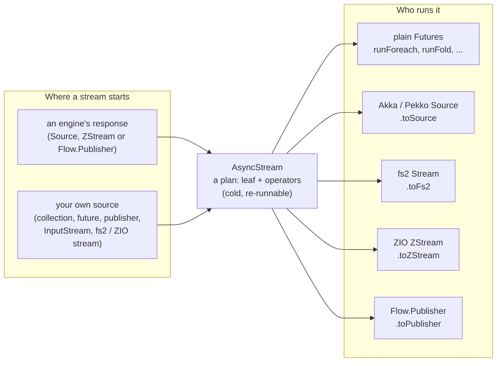
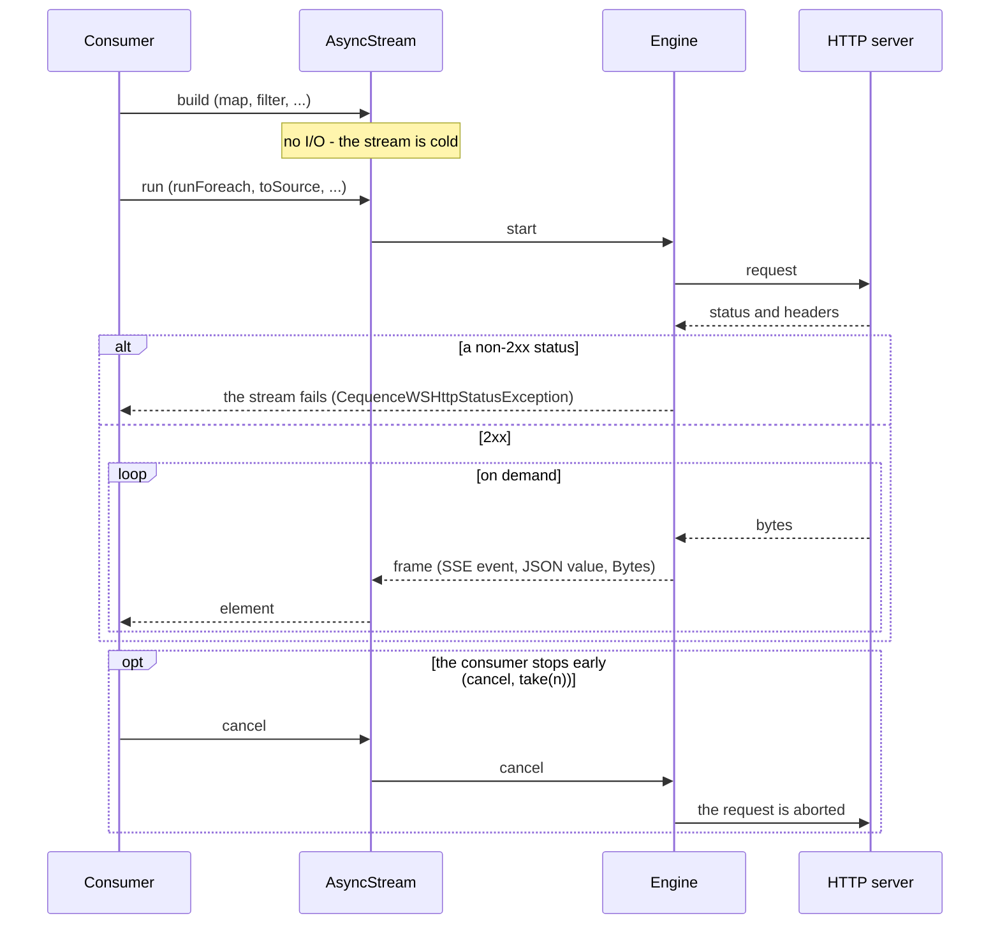

# Streaming 🌊

[← back to the README](../README.md)

Streamed responses - SSE / JSON frames and raw bytes - come in several types. This page shows
which stream abstraction you get where, then covers the backend-neutral `AsyncStream` (since
1.2.0) in depth: semantics, operators, interop with Akka, Pekko, fs2 and ZIO, and downloads.

## Stream abstractions at a glance

| Stream type | Module | You get it from | Use it when |
|---|---|---|---|
| `AsyncStream[A]`, `AsyncPipe[A, B]` | ws-client-core | `execJsonAsyncStream` / `execRawAsyncStream` on every streaming engine; services on `WSClientWithEngineAsyncStreamingBase` | your code should not pick a streaming library: runs on plain `Future`s, converts to every type below |
| Akka `Source` | ws-client-core-akka | `execJsonStream` / `execRawStream` on the Akka engines; `.toSource` on an `AsyncStream` | an Akka application; streamed request bodies (`execPOSTSource`) |
| Pekko `Source` | ws-client-core-pekko | the same names, on the Pekko engines | a Pekko application |
| fs2 `Stream[F, A]` | ws-client-fs2 | `.toFs2[F]` on an `AsyncStream` | a cats-effect / fs2 application |
| ZIO `ZStream` | ws-client-zio | `.toZStream` / `.toZByteStream` on an `AsyncStream` | a ZIO application (native on `zio-http`) |
| `java.util.concurrent.Flow.Publisher` | ws-client-core (JDK type) | `execJsonStreamPublisher` / `execRawStreamPublisher`; `.toPublisher` on an `AsyncStream` | any other Reactive Streams consumer |

An `AsyncStream` is an immutable **plan** - a leaf (where the elements come from) plus
operators. Whoever consumes it compiles the plan for its own library, so nothing is converted
element by element unless two different libraries really meet:



Streamed **request** bodies exist only `Source`-typed: `execPOSTSource` / `execPOSTSourceRich`
on the Akka / Pekko engines (`StreamedEngineRegistry.inputStreamed()`,
`WSClientWithEngineInputStreamingBase` for services).

## A streamed call



Every engine checks the HTTP status **before** it exposes a streamed body: a non-2xx status
fails the stream with a `CequenceWSHttpStatusException(statusCode, body)` (at most 4 KiB of the
error body are read). SSE comment lines (`:` keep-alives) and blank frames are skipped, `[DONE]`
ends the stream, and a frame longer than `maxFrameLength` fails it with a
`CequenceWSFrameTooLongException`. The frame delimiter is `\n\n` by default; servers that
terminate events with `\r\n\r\n` need the `framingDelimiter` argument.

## Backend-neutral streaming: `AsyncStream`

Since 1.2.0 every streaming engine returns its SSE / JSON and raw byte streams also as an
`AsyncStream` (`io.cequence.wsclient.stream`, in `ws-client-core` - no Akka, Pekko, fs2 or ZIO
needed), and every consumer runs it: plain `Future`s, Akka, Pekko, fs2 or ZIO.

```scala
import io.cequence.wsclient.service.spi.WSClientEngineRegistry
import io.cequence.wsclient.stream.AsyncStream

val engine = WSClientEngineRegistry.outputStreamed()   // any engine with output streaming

val texts: AsyncStream[String] =
  engine
    .execJsonAsyncStream(site, "chat/completions", "POST", bodyParams = body)
    .map(json => (json \ "text").asOpt[String].getOrElse(""))
    .filter(_.nonEmpty)

texts.runForeach(println)           // runs on the given ExecutionContext - nothing else needed
```

### Semantics

- **Cold and re-runnable:** building a stream does no I/O; each run is a new request (so a
  re-run is a new - possibly billed - call). Every thunk (`defer`, a `stateful` init, a
  publisher factory, `future`, a `concurrently` task, a blocking `open`) runs per run.
- **Per-run state:** allocate mutable state only inside `AsyncStream.defer`, a `stateful` init
  or a `statefulMapConcat` create - never when building a stream or a pipe, or every run shares
  it.
- **Back-pressured, one consumer per run;** fan-out goes through the hot `AsyncBroadcastHub`.
- **Cancellation** travels to the leaf: it aborts the HTTP request, closes an `InputStream` or a
  blocking iterator. A downstream `take(n)` cancels the upstream after the n-th element.
- **Recursive streams** (paging, polling, reconnecting) run in constant stack when the recursive
  call is in tail position - `page ++ next`, the last stream of a `flatMapConcat`, a
  `recoverWith` or `futureStream` continuation:
  `def page(i: Int): AsyncStream[Page] = AsyncStream.future(fetch(i)).flatMapConcat(p => AsyncStream.single(p) ++ page(i + 1))`.
  The neutral interpreter and fs2 run every such shape in linear time (100,000 levels in under
  2 s), Akka / Pekko `++` / `flatMapConcat` / `futureStream` recursion too. Two shapes cost time
  quadratic in the depth: `recoverWith` recursion on Akka / Pekko (10,000 levels: about 20 s)
  and `flatMapConcat` / `futureStream` recursion on ZIO (10,000 levels: about 2.5 s, 50,000:
  over a minute). Recursion that is not in tail position (an operator applied to the recursive
  call's result) nests one level per step: on the neutral interpreter a run nested deeper than
  the thread's stack fails with a `CequenceWSException`.
- **Failures** of user functions (and failed `evalMap` futures) fail the stream with that
  exception, unwrapped; there is no resume supervision. `guaranteeCase` / `onTerminate` hooks
  run exactly once per run (`Completed` / `Failed` / `Cancelled`), and a `stateful` end hook and
  a `Completed` hook finish before the completion goes downstream.

### Operators

- **Transforming:** `map`, `mapConcat`, `filter`, `filterNot`, `collect`, `evalMap` (one future
  at a time), `stateful` / `statefulMapConcat`, `scan`, `fold`, `zipWithIndex`, `take`,
  `takeWhile`, `drop`, `concat` / `++`, `flatMapConcat`, `via(pipe)`, `zipVia`, `mapError`,
  `recover`, `recoverWith`, `onTerminate` / `guaranteeCase`,
  `concurrently(task, awaitCompletion)`, `preflight`.
- **Running:** `runForeach`, `runFold`, `runToSeq`, `runHead(Option)`, `runLast(Option)`,
  `runDrain`, `run(f)` (cancellable), `toPublisher`; `describe` shows the plan (never elements).
- **Pipes and framing:** `AsyncPipe[A, B]` is a reusable transformation with the same operators
  (`AsyncPipe.of[A].map(...)`); `ByteFraming.delimiter` / `lines` and
  `JsonStreamPipes.jsonFrames` frame any byte stream exactly as the engines do. Byte streams
  carry the immutable `Bytes`.

### Interop - native round trips

A stream is a plan, so a backend runs its own streams natively: an Akka engine's stream consumed
as an Akka `Source` is that engine's own `Source`, with every operator an Akka stage -
`source.toAsyncStream.toSource eq source`; likewise the `zio-http` engine's streams consumed
with `toZStream` / `toZByteStream` are its own ZIO streams. A bridge through
`java.util.concurrent.Flow` is built only at a foreign leaf (once) or a foreign native pipe
(twice).

| Library | Module | Import | To | From |
|---|---|---|---|---|
| Akka | ws-client-core-akka | `io.cequence.wsclient.stream.SourceInterop._` | `.toSource`, `.toByteStringSource`, `.toFlow` | `.toAsyncStream`, `.toAsyncByteStream`, `.toAsyncPipe` |
| Pekko | ws-client-core-pekko | the same names | the same | the same |
| fs2 | ws-client-fs2 | `io.cequence.wsclient.stream.Fs2Interop._` | `.toFs2[F]`, `.toFs2Pipe[F]` | `.toAsyncStream` (needs an `Fs2Runner`, e.g. from an `IORuntime`), `Fs2Interop.fromFs2Pipe` |
| ZIO | ws-client-zio | `io.cequence.wsclient.stream.ZioInterop._` | `.toZStream`, `.toZByteStream`, `.toZStreamFunction` | `.toAsyncStream`, `.toAsyncByteStream` (need a `Runtime`), `ZioInterop.fromZPipeline` |

Which engine's `AsyncStream` is native to which library:

| Engine | Its stream is natively | Consumed as that type | Consumed as anything else |
|---|---|---|---|
| `play-akka-stream` | an Akka `Source` | 0 bridges | 1 bridge |
| `play-pekko-stream`, `pekko-http` | a Pekko `Source` | 0 bridges | 1 bridge |
| `zio-http` | a ZIO `ZStream` | 0 bridges | 1 bridge |
| `jdk` | a `Flow.Publisher` | 0 bridges on plain `Future`s | 1 bridge |

The `Materializer` / `Fs2Runner` / `Runtime` a conversion takes is used only when the stream is
consumed outside its own library.

**Migrating 1.x code.** For 1.x code written against Akka `Source`s,
`import io.cequence.wsclient.stream.SourceConversions._` (likewise `Fs2Conversions._`,
`ZioConversions._`) adds opt-in implicit conversions - e.g.
`stream.runWith(Sink.foreach(println))` compiles unchanged; they are `implicit def`s,
warning-free under `-feature` on Scala 2 and 3.

**Counting bridges.** Count bridges in a test with
`StreamDiagnostics.counted(stream.toSource)` - scoped to the streams compiled or started inside
it.

**Differences between backends.** Three:

- On a failure, Akka's / Pekko's stages fail fast - the failure overtakes the elements a stage
  still holds (`flatMapConcat`, `evalMap`: those in flight; `mapConcat`: the rest of that
  element's output), where the neutral interpreter, fs2 and ZIO deliver them before the failure.
- fs2 / ZIO read an iterator (`fromIterator`, a `mapConcat` result) ahead of the demand - one
  element first, then chunks doubling up to 64 - where the neutral interpreter and Akka read one
  element per demand: an iterator with side effects can be advanced past an early stop there.
- On ZIO, a ZIO stream that ends with an interruption it raised itself (e.g. joining an
  interrupted fiber) stays an interruption (`recover` / `mapError` do not apply, `onTerminate`
  sees `Cancelled`), where the other backends see a failure.

A pipe turned into an Akka `Flow` (`toFlow`) reads the flow's input once: a pipe that reads its
input twice fails there.

### Services and downloads

`WSClientWithEngineAsyncStreamingBase` is the backend-neutral counterpart of
`WSClientWithEngineOutputStreamingBase` (same method names, so porting a service is a mixin
swap): `execJsonStream` / `execRawStream` return `AsyncStream`s whose non-2xx failures go
through the service's `handleErrorCodes`, and binary-safe downloads work on every streaming
engine:

- `execGETBytes` / `execPOSTBytes` collect the body (at most `maxBytes`, 256 MiB by default).
- `execGETStream` / `execPOSTStream` complete once the body started - its first chunk arrived,
  or it ended (`None` for a 404) - with a single-run stream of the body.
- On an engine whose streams are native (the Akka / Pekko engines, `zio-http`) that body stays
  the engine's own stream: the up-front status check runs inside that backend, so a download
  consumed with `toByteStringSource` / `toZByteStream` crosses no bridge.
- A service on the plain `WSClientWithEngineBase` gets the same downloads as the protected
  `execBytesDownload` / `execStreamDownload` (GET, POST, PUT, PATCH or DELETE; body parameters
  on POST / PUT / PATCH only) - on an engine without output streaming they buffer the response
  (a single-element stream).
- A collected streamed download is bounded per engine (the Play stream engines by the request
  timeout, `jdk` / `zio-http` only by the gaps between chunks): for a total bound, run the
  stream of `execStreamDownload` and cancel it on a timer.

Buffered responses are binary-safe too: `Response.bytes` is the body exactly as received, on
every engine (the text stays in `string`); `BytesBackedResponse` is the bytes-first `Response`
for your own code. `DeferredPublisher` (a cold `Flow.Publisher` that calls its factory on
subscription - single-shot: a second subscriber gets `onError(IllegalStateException)`; wrap it
in `AsyncStream.fromPublisher(() => ...)` for a re-runnable stream) is public as well.

### More building blocks

- `AsyncBroadcastHub(upstream, bufferSize, drain)` - a hot fan-out whose `source(prefix)`
  registers a consumer per run.
- `preflight` - start a run now and fail early (e.g. on a 404) before handing the stream on (a
  stream over a native Akka / Pekko or ZIO source is preflighted by that backend, on the
  source's own materializer / runtime, and stays native).
- `AsyncStream.fromInputStream` / `fromBlockingIterator` - blocking sources read on a dedicated
  pool, the same way on every backend: a cancel never waits for a stalled read, and `close()`
  follows the last read, exactly once.
- `io.cequence.wsclient.concurrent.AsyncScheduler` / `Futures.after` / `delay` / `timeout` -
  timers without an actor system (the default is in implicit scope; `ActorSchedulers._` adapts
  an Akka / Pekko scheduler, `ZioInterop.scheduler` ZIO's clock).
- `PollingHelperCore` and `ParallelServiceAdapters.parallelTakeFirst` - Akka-free polling and
  parallel calls.

### Engine resolution

`sttp`, `play-akka` and `play-pekko` have no output streaming: resolve streamed services through
`WSClientEngineRegistry.outputStreamed`, which picks the highest-priority engine that streams -
with `play-akka` and `jdk` on one classpath, streams then run on `jdk`. See
[Engines](engines.md).

## `Source`-typed streaming (Akka / Pekko)

The Akka / Pekko engines also expose their streams directly as `Source`s - the API of 1.0 / 1.1,
unchanged:

```scala
import io.cequence.wsclient.service.spi.StreamedEngineRegistry

val engine = StreamedEngineRegistry.outputStreamed()

engine
  .execJsonStream(site, "chat/completions", "POST", bodyParams = body)   // Source[JsValue, NotUsed]
  .runForeach(println)
```

Services extend `WSClientWithEngineOutputStreamingBase` (`execJsonStream` / `execRawStream`,
with non-2xx stream failures classified through the service's `handleErrorCodes`); on
engine-level calls append `.mapError(mapHttpStatusErrors)` for the same classification.

## `Flow.Publisher`-typed streaming

Every streaming engine implements `WSClientOutputStreamCore`, whose `execJsonStreamPublisher` /
`execRawStreamPublisher` return a `java.util.concurrent.Flow.Publisher` - the JDK's Reactive
Streams type, which any Reactive Streams library can consume. An `AsyncStream` becomes one with
`.toPublisher`.
