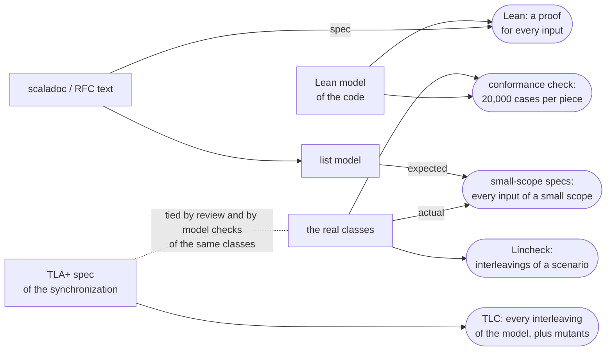

# Verification 🔬

[← back to the README](../README.md)

The stream layer (1.2.0) is checked beyond example-based and random tests, in three layers that
each check every case of a *small* scope, or every interleaving of a *small* scenario - where
most concurrency and edge-case bugs already show. A fourth layer proves, for every input, what
four pure parts compute: delimiter framing, query encoding, multipart parameter encoding and
SSE frame parsing.

## The four layers

| Layer | Checks | Run | Current scope |
|---|---|---|---|
| Small-scope (bounded-exhaustive) specs | the code against a list model written from the scaladoc alone, on EVERY input of a small scope | part of `sbt test` | framing: every string up to 5 bytes x every chunking x 4 frame limits x 5 delimiters (about 130,000 cases); operators: every pipeline of up to 2 operators over small sources, with a failure injected at every user function (38,740 pipelines on each of 4 backends); calls: every `AsyncCall` plan of up to 3 operators over 25 leaves (698,275 plans on each of 2 interpreters), and plan TREES - an operator's function returns plans of its own - with a cancellation at the first gate (895,400 plans of depth 3 plus 200,000 random deep ones, on both interpreters and a model of the run loop); the fs2 pull bridge: every scripted cursor of up to 4 steps under every way a run can end (one outstanding `next()`, one cancel) |
| Model checks ([Lincheck](https://github.com/JetBrains/lincheck)) | the real classes under the interleavings of a scenario's threads: deadlocks, hangs, lost signals | `sbt modelCheck` (about 7 minutes) | 35 scenarios x 1000 interleavings: `TransformPublisher`, `CursorPublisher`, `SubscriberCursor`, `AsyncBroadcastHub`, `ZioCursor`, a run of an `AsyncCall`, the neutral preflight |
| TLA+ specs (TLC) | the synchronization *designs*, every interleaving of a model, deadlock freedom and termination included | `formal/tla/check.sh --fetch` (about 11 minutes; 16 with `--slow`) | 8 specs (`ZioCursor`, the `CursorPublisher` drain loop, two chained `TransformPublisher`s, the preflight's hand-over, `SubscriberCursor`, `AsyncBroadcastHub`, and the two races of an `AsyncCall` run: a timeout and `traverse`), 32 configurations of up to 4 million states, 35 mutants |
| Lean proofs ([Lean 4](https://lean-lang.org)) | the code itself (query encoding, multipart parameters, SSE frames, both delimiter framers: EXTRACTED from the shipped Scala) against a spec written from the scaladoc / RFC, for EVERY input; a conformance check runs the shipped code and the Lean on the same random cases | `formal/lean/check.sh` (about 30 seconds), then `sbt leanConformance` (about a minute) | 53 theorems: both framers, `WireFormat.encodeQueryComponent` / `url`, `MultipartParams`, `JsonStreamFrames.parseFrame`; 20,000 conformance cases per piece by default (500,000 in the audit run) - and the run loop of `AsyncCall`, whose Lean model is extracted from the Scala source the tests run |

## State

All four layers pass; the CI workflow runs them (the last three in a job of their own).

- *Operators:* the neutral interpreter, fs2 and ZIO match the model on every pipeline of the
  scope (also at depth 3, 364,164 pipelines per backend -
  `-Dwsclient.verify.operators.depth=3`, 2 minutes); Akka differs only in the documented way (a
  failure overtakes elements a stage still holds).
- *Calls (since 1.3.0):* the `Future` interpreter and the ZIO compiler of `AsyncCall` match the
  model - a call is its outcome and what its hooks saw - on every plan of the scope
  (`-Dwsclient.verify.calls.depth`, default 3): values, failures, throwing user functions,
  `Future` and native ZIO leaves (a defect included), `sleep`, `traverse`, recovery, hooks,
  with a throw injected at every kind of user function.
- *Framing:* `ByteFraming.delimiter` and the engines' framer agree with each other on the whole
  scope and with the model except for two known edges, which the spec names and pins (it fails
  once they are fixed): a frame within `delimiter.length - 1` bytes of the limit fails when a
  chunk boundary splits its delimiter, and frames completed in the same chunk as an oversized
  frame are dropped with the failure.
- *Model checks:* the scenarios include the two races fixed on the way to 1.2.0 - a cancel
  racing the next element across two chained transforms (the released 1.1.5 deadlocks there),
  and an upstream result racing `AsyncBroadcastHub.shutdown()`. The eight scenarios of a call's
  run (since 1.3.0) race `cancel()`, a timeout's timer and a failing `traverse` element against
  completions; the timer scenario found, before any release, a call that finished just as its
  timeout fired and whose outcome was neither returned nor reported late - it now also checks
  that the outcome of a request that was sent is never lost.
- *TLA+:* every spec holds for its configurations; the 1.1.5 design of `TransformPublisher`,
  kept as a configuration, deadlocks as expected; the preflight's hand-over holds, and TLC finds the
  documented window (a stream handed over in the instant its caller cancelled stays open) on
  purpose; each of the 35 mutants (one seeded bug per patch) is rejected. Since 1.3.0 the
  designs of `SubscriberCursor` (the lock-free loop that serializes `request` / `cancel`),
  `AsyncBroadcastHub` (the buffer trimmed by the slowest consumer, the first terminal event,
  `shutdown()`, the refill pull) and the two races of an `AsyncCall` run - a timeout (the child
  run, the timer and a cancel race for one suspension, the loser's outcome reported once) and
  `traverse` - are specified and checked. Details, invariants and state counts:
  [`formal/tla/README.md`](../formal/tla/README.md).
- *Lean (since 1.3.0):* both framers compute the same function of the chunks, and against the
  scaladoc model they differ only at the two edges above - proved for every input, so those are
  the only differences there are. `WireFormat.encodeQueryComponent` is exactly RFC 3986's
  encoding of every text, and a strict reader takes back from `url` exactly the parameters, for
  any base without a `#`. `MultipartParams` is the WHATWG encoding; an encoded value can never
  leave its parameter. `parseFrame` is exactly its scaladoc's rules on the frame's lines - its
  fast path and its search in the joined content included. Surfaced on the way: a backslash in a
  multipart name goes out as it is (as browsers send it), which an RFC 9110 quoted-string reader
  takes as an escape. The framers are also free of `int` overflow and array exceptions, for any
  input of at most `Int.MaxValue - 8` bytes (the checked extraction above). Details:
  [`formal/lean/README.md`](../formal/lean/README.md).

## The code itself, in Lean (extracted)

For three of the four pure pieces nothing is transliterated: `sbt leanExtract` parses the
SHIPPED Scala (`WireFormat`, `MultipartParams`, `JsonStreamFrames.parseFrame`) and translates it
construct by construct into Lean (`Extracted.lean`, with the Scala quoted above each
definition); the proofs are about that translation. The Java / Scala library calls it meets
(`trim`, `indexOf`, `substring`, `replace`, `Pattern.split`, `URLEncoder.encode`, ...) go to a
small prelude written from their documentation, which the conformance target `lib` runs
against the JVM (300,000 random texts identical, supplementary characters and controls
included). Three decisions are named in the generated files: `Json.parse` is the free
constructor (the frame result is the string handed to it), a `try` whose handlers all rethrow
is its body, and a value of type `Any` is its `toString`.

A change to one of these methods regenerates the Lean and the proofs are re-checked against the
new code. Shown on a planted bug in the shipped `parseFrame` (`substring(1)` to `substring(2)`):
`leanExtract --check` fails (stale file) and, regenerated, `parseFrame_eq_reference` no longer
builds. The two framers are imperative classes (private `var` fields, `while` loops over byte arrays with
an early `return`, `System.arraycopy`, `throw`): a second extractor, `ClassExtract`, translates
them the same way - the fields a state, the loops recursive functions over a step counter (the
`fuel` of every method; running out of it is its own failure, and the extraction decides
nothing about termination), the exceptions `Except`. The older proofs are about a hand-written
model with `Nat` indices; `ByteFramingRefinement` / `EngineFramerRefinement` prove the extracted
code equal to it, function by function, so every framer theorem (`framers_equivalent`, the
`*_frames_prefix` / `*_tooLong_of_reference` / `*_eq_reference_*` / `*_chunking_independent`
family) is restated about the shipped code (`ExtractedTheorems`) - together with the fact that
the loops never run out of the fuel the stage gives them. A bug planted in either framer's
compaction fails `leanExtract --check` and, regenerated, the refinement. What stays hand-written
is what runs the framers - `ByteFraming.delimiter`'s stage and the engines' `TransformPublisher`
(`push` / `onInput` per chunk, the first exception fails the stream, `finish` /
`onUpstreamComplete` at the end): two small drivers, each pinned to its Scala member
(`formal/lean/pins.txt`, a hash of its tokens) - a change fails `leanExtract --check` until the
driver is re-read.

The unchecked extraction runs on Lean's unbounded `Int` and reads an array outside its bounds
as `none`: it models no `int` that wraps and no `ArrayIndexOutOfBoundsException`. So each framer
is extracted a SECOND time, in checked mode (`*Checked.lean`): every `Int` / `Long` operation is
a step of `Except` that fails where Java wraps (`intOverflow`, `longOverflow`), and so are every
array read, `Arrays.copyOf` / `copyOfRange`, `System.arraycopy`, `new Array` and array `++` (the
exceptions the JDK throws, in the order it checks them). `ByteFramingSafety` and
`EngineFramerSafety` prove the checked code EQUAL to the unchecked one, function by function,
under an invariant (offsets ordered and non-negative, lengths at most `Int.MaxValue - 8`) that
every step preserves - and carry it through the whole stage (`byteRunC_eq`, `engineRunC_eq`):
for any input of at most `Int.MaxValue - 8` bytes the checked run, in which every Java failure
is a result, never meets one and ends exactly as the unchecked run. So what is proved about the
unchecked code holds for the Java code. The checked prelude (`Java.readChecked`,
`copyOfRangeChecked`, ..., `Scala.int32?`) is run against the JVM by the `lib` conformance target
- every exception of the JDK, the boundaries of `int` and `long` included; its first run found
the JDK's order of checks, which the javadoc does not state (`copyOfRange` reports `from > to`
before a bad `from`).

## One source for the tests and the proof (calls)

For the run loop of `AsyncCall` the model is likewise not transliterated: `CallModel.scala` (in the verification module) is a small Scala subset -
plans as first-order data, `denote` (what a plan means, from the scaladoc), and `step` (the
frame-stack machine of `CallFiber`) - and it is used twice:

- `CallTreeSpec` runs every plan of a scope, and a large random sample of deep ones, through
  the `Future` interpreter and the ZIO compiler, cancelling the run where it first parks at a
  `Gate`, and requires the end (a value, a failure, cancelled) and the hook log to equal
  `denote` - and the machine to reach the same.
- `sbt leanExtract` parses that same file (scalameta) and translates it construct by construct
  into `formal/lean/WsClientProofs/Calls/Model.lean`; anything outside the subset fails the
  extraction. `Calls/Proofs.lean` proves, for EVERY plan, that the machine ends with `denote`
  (`machine_correct`), and `Calls/StackProofs.lean` that it never holds more frames than the
  plan's nesting depth (`stack_bounded`: a chain of continuations or a retry chain of any length
  runs on one frame - the loop's stack safety, for every depth).

So what the tests compare the real interpreters with is exactly what is proved, and nothing is
transliterated by hand. Two checks guard the chain: `leanExtract --check` fails when the
generated Lean is out of date, and `leanExtract --cases N` evaluates the generated Lean in the
Lean interpreter on N plans against the Scala model (a translation error - an operator, a
pattern order - would show there). Each was first shown to fail on a planted bug: a wrong
recovery in the machine makes the proof fail; `+` translated as `-` makes 71 of 500 plans
differ.

The plan trees found a real defect before release: on ZIO, a run interrupted while parked below
a `timeout` ran the hooks above the timeout BEFORE the hooks below it, because ZIO's own
`timeout` interrupts its loser in the background (the `Future` interpreter waits). The timeout
now waits for its upstream.

## Not covered (yet)

The scopes are small by design (a few elements, two or three calls per thread, pipelines of two
or three operators). The TLA+ specs model the synchronization, not the data, and are tied to the
code only by review and by the model checks of the same classes (every specified class has
scenarios for the same races); the model checks sample interleavings and check no liveness. There
is no design-level spec of the Akka / Pekko stages, and the engines' HTTP paths are covered by
example-based and scenario tests only. A call's run has TLA+ specs of its two races (the timeout
and `traverse`, the suspension hand-over inside both) and a Lean proof of its SEQUENTIAL run loop
and one cancellation - no Lean model of the concurrent parts, and nothing of a cancellation
that races a step, of time, or of `traverse` / races / streams inside the plan trees (the model
checks and the linear small-scope spec cover those). The Lean proofs are about the shipped code
through the extractors - what the extraction trusts is the library prelude, the translators and
the decisions named in the generated files; the framers' stage drivers are hand-written and
pinned, and the conformance check - which runs the shipped stages on four backends and the
engines' `TransformPublisher` against the Lean - samples the link between the shipped code and
the Lean. The fs2 pull bridge is checked by a small-scope spec of its invariants (one
outstanding `next()`, one cancel), not by a model check or a TLA+ spec.
