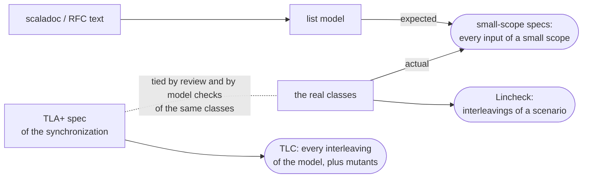

# Verification 🔬

[← back to the README](../README.md)

The stream layer (1.2.0) is checked beyond example-based and random tests, in three layers. None
of them is a proof: each checks every case of a *small* scope, or every interleaving of a
*small* scenario - where most concurrency and edge-case bugs already show.

## The three layers

| Layer | Checks | Run | Current scope |
|---|---|---|---|
| Small-scope (bounded-exhaustive) specs | the code against a list model written from the scaladoc alone, on EVERY input of a small scope | part of `sbt test` | framing: every string up to 5 bytes x every chunking x 4 frame limits x 5 delimiters (about 130,000 cases); operators: every pipeline of up to 2 operators over small sources, with a failure injected at every user function (25,616 pipelines on each of 4 backends) |
| Model checks ([Lincheck](https://github.com/JetBrains/lincheck)) | the real classes under the interleavings of a scenario's threads: deadlocks, hangs, lost signals | `sbt modelCheck` (about 7 minutes) | 25 scenarios x 1000 interleavings: `TransformPublisher`, `CursorPublisher`, `SubscriberCursor`, `AsyncBroadcastHub`, `ZioCursor` |
| TLA+ specs (TLC) | the synchronization *designs*, every interleaving of a model, deadlock freedom and termination included | `formal/tla/check.sh --fetch` (about 5 minutes) | 3 specs (`ZioCursor`, the `CursorPublisher` drain loop, two chained `TransformPublisher`s), 8 configurations of up to 4 million states, 9 mutants |

## State (1.2.0)

All three layers pass; the CI workflow runs them (the last two in a job of their own).

- *Operators:* the neutral interpreter, fs2 and ZIO match the model on every pipeline of the
  scope (also at depth 3, about 270,000 pipelines per backend -
  `-Dwsclient.verify.operators.depth=3`, 2 minutes); Akka differs only in the documented way (a
  failure overtakes elements a stage still holds).
- *Framing:* `ByteFraming.delimiter` and the engines' framer agree with each other on the whole
  scope and with the model except for two known edges, which the spec names and pins (it fails
  once they are fixed): a frame within `delimiter.length - 1` bytes of the limit fails when a
  chunk boundary splits its delimiter, and frames completed in the same chunk as an oversized
  frame are dropped with the failure.
- *Model checks:* the scenarios include the two races fixed on the way to 1.2.0 - a cancel
  racing the next element across two chained transforms (the released 1.1.5 deadlocks there),
  and an upstream result racing `AsyncBroadcastHub.shutdown()`.
- *TLA+:* every spec holds for its configurations; the 1.1.5 design of `TransformPublisher`,
  kept as a configuration, deadlocks as expected; each of the 9 mutants (one seeded bug per
  patch) is rejected. Details, invariants and state counts:
  [`formal/tla/README.md`](../formal/tla/README.md).

## Not covered (yet)

The scopes are small by design (a few elements, two or three calls per thread, pipelines of two
or three operators). The TLA+ specs model the synchronization, not the data, and are tied to the
code only by review and by the model checks of the same classes; the model checks sample
interleavings and check no liveness. There is no design-level spec of `SubscriberCursor`,
`AsyncBroadcastHub` or the Akka / Pekko stages, no model check of the fs2 bridge, and the
engines' HTTP paths, the wire format (`WireFormat.url`, multipart encoding) and SSE frame
parsing are covered by example-based and scenario tests only.
